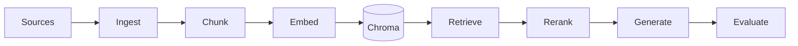

# Step criticality (what matters most)

Use this when prioritizing fixes or study time.

| Step | Name | Criticality | Typical failure symptom |
|------|------|-------------|-------------------------|
| 0 | Health / config | Medium | Wrong DB URL, missing API key |
| 1 | Ingestion | **High** | Empty text, garbled PDF, blocked URLs |
| 2 | Chunking | **High** | Right fact split across chunks |
| 3 | Embedding | **Critical** | Nonsense similarity, wrong dimensions |
| 4 | Vector index | **Critical** | Stale or missing vectors |
| 5 | Retrieval | **Critical** | Irrelevant context in top-k |
| 5b | Reranking | Medium | Right doc at rank 8, never seen by LLM |
| 6 | Generation | **High** | Ignores context or invents facts |
| 7 | Pipeline orchestration | High | Partial index, no error handling |
| 8 | Evaluation | Medium (process) | Unknown quality until users complain |

## Suggested learning loop

1. Run **offline eval** — establish baseline metrics.
2. Change **one knob** (`CHUNK_STRATEGY`, `TOP_K`, `RERANK_MODE`).
3. Re-index practice corpus and re-run eval.
4. Only then enable **RAGAS/DeepEval** for LLM-judged scores.

## Mermaid — happy path

