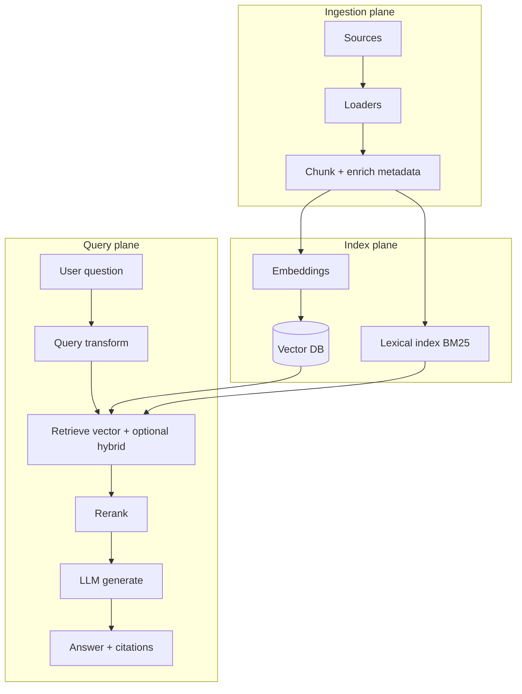

# Enterprise RAG architecture (reference)

## Simple mental model

## Planes explained like a building

| Plane | Job | This repo |
|-------|-----|-----------|
| Ingestion | Get trustworthy text | `src/ingestion/` |
| Index | Make text searchable | `step03`–`step04`, BM25 in `step05` |
| Query | Answer safely | `step05`–`step07` |
| Observe | Know if it works | `step08`, Prometheus |

## Enterprise use cases (practice files included)

| Use case | Sample corpus | Typical risk |
|----------|---------------|--------------|
| Employee HR policies | `enterprise_hr_policy.md` | Wrong leave numbers |
| IT runbooks & SLA | `enterprise_it_runbook.md` | Wrong escalation / SLA |
| Customer support FAQ | `acme_support_faq.md` | Returns / warranty errors |

## Deployment checklist (production)

1. **Secrets** — API keys in vault, not git.
2. **Classification** — tag chunks `internal` / `confidential`; filter at query time.
3. **Hybrid retrieval** — turn on when keyword matters (SKUs, error codes, legal cites).
4. **Rerank** — after top-20 retrieve, rerank to top-5 for the LLM.
5. **Grounding** — system prompt refuses when context is empty (see `Generator`).
6. **Eval set** — maintain `eval_dataset.json` per domain; run in CI weekly.
7. **Logging** — store question, chunk ids, latency (`query_logs` table).

## Scaling patterns (read-only overview)

- **Async ingestion queue** — S3 upload → worker indexes (not in this repo; pattern only).
- **Blue/green index** — build new collection, swap alias at cutover.
- **Caching** — cache embeddings for frequent questions; invalidate on reindex.

Next: [09-hybrid-search-and-metadata.md](09-hybrid-search-and-metadata.md).
